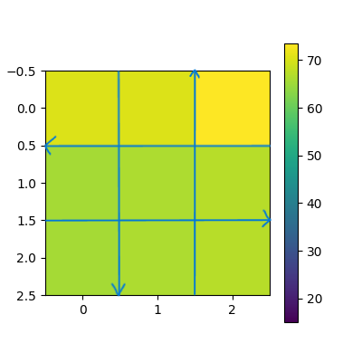
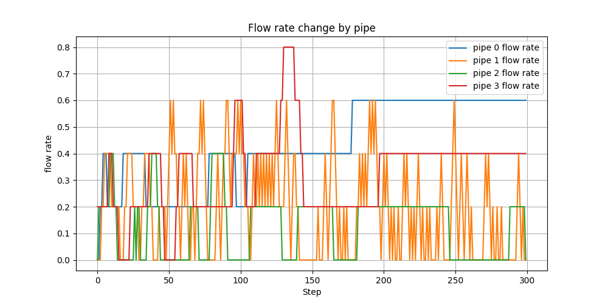
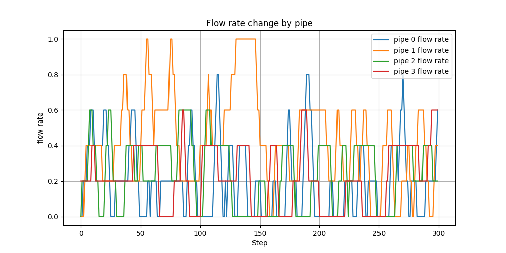
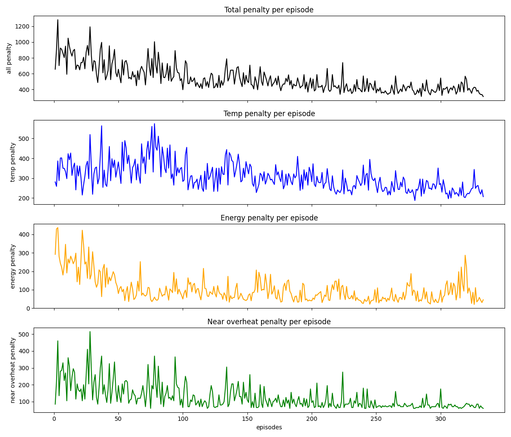
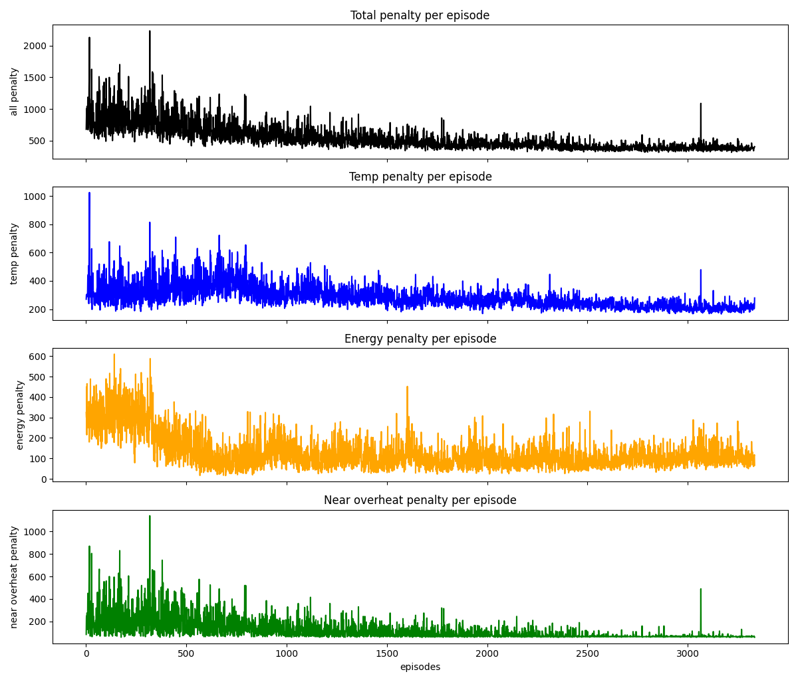
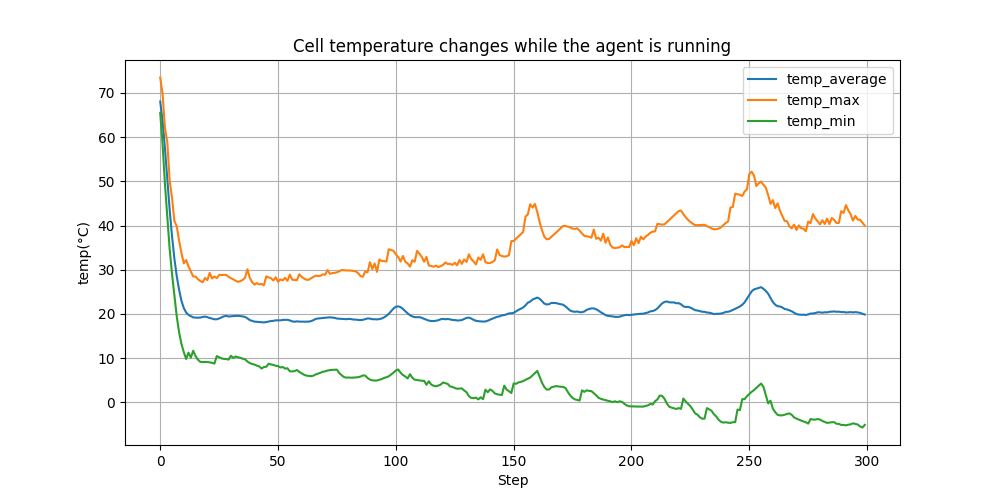

# DQN 냉각 제어 (Cooling Control with DQN)

3×3 셀 냉각 환경에서 **적은 유량으로 온도를 낮추도록** DQN 에이전트를 학습시킨 학부 전공 강의 개인 프로젝트입니다. (홍익대학교 기계시스템디자인공학과, 2025)

다른 수업에서 한 조가 "유량을 조절하는 제어 함수를 만드는 것이 가장 어렵다"고 발표한 냉각 문제를 보고, 셀 온도와 통로 유량을 상태로, 유량 증감을 행동으로 두면 강화학습 문제로 바꿀 수 있겠다고 생각해 시작했습니다.

> **구현 방식에 대해:** 코드는 대부분 ChatGPT로 작성했습니다(보고서에도 명시). 문제 정식화, 행동 공간 축소, 보상 설계, 하이퍼파라미터 실험과 결과 분석은 직접 했습니다.

---

## 환경



- 3×3 셀이 각각 열원이고, 가로 2개·세로 2개 총 4개 통로로 냉매가 흐르며 양옆 셀과 열을 교환합니다. 냉매 온도는 통로를 지날수록 올라갑니다.
- 고발열 셀이 무작위로 생기고 옮겨 다녀 발열에 무작위성이 있습니다.
- 통로 유량은 6단계(0 ~ 최대)입니다.
- 이전 상태(온도·유량)와 행동만 다음 상태를 결정하므로 MDP로 볼 수 있습니다.

## 강화학습 설정

| 항목 | 내용 |
|---|---|
| 상태 (13) | 셀 온도 9 + 통로 유량 4 |
| 행동 (9) | 통로 4개 × (증가/감소) + 전체 유지. 처음엔 네 통로를 동시에 조절하는 3⁴ = 81개였으나 학습이 저하돼 한 스텝에 한 통로만 조절하도록 축소 |
| 보상 (페널티) | ① 온도: 기준 25℃ 초과분 제곱 / 100 ② 에너지: 펌프 동력이 유량³에 비례 → 유량³ / 125 ③ 과열: 65℃ 이상 셀 수 × 5 (처음엔 지수형이었으나 값 편차가 커 정규화가 어려워 셀 수 비례로 변경) |
| 알고리즘 | Stable-Baselines3 DQN (MlpPolicy), Gymnasium 커스텀 환경 |

## 실험

| | Case-1 | Case-2 |
|---|---|---|
| learning_rate | 1e-3 | 1e-4 |
| buffer_size | 10,000 | 50,000 |
| learning_starts | (기본값) | 100,000 |
| 학습 스텝 | 1,000,000 | 10,000,000 |
| 공통 | batch 64, train_freq 4, target_update 500, γ 0.99, ε 1.0→0.02 (exploration_fraction 0.8) | |

### 결과: 학습된 정책으로 300스텝 제어 시 통로별 유량

| Case-1 | Case-2 |
|---|---|
|  |  |
| 주로 1번 통로만 조절 | 네 통로를 나눠 조절 |

- 두 경우 모두 에피소드 페널티는 약 500 근처로 수렴했지만 Case-2가 더 안정적이었습니다.
- Case-1이 한 통로에 쏠린 원인을 **초반 탐색 부족**으로 보고, Case-2에서 탐색 전용 구간(learning_starts)을 두고 학습률을 낮춰 더 오래 학습시켰습니다.

| 에피소드별 페널티 (Case-1) | 에피소드별 페널티 (Case-2) |
|---|---|
|  |  |

### 한계와 개선 방향



- 고온 셀이 60℃에 가까워지기 전에 온도를 낮추긴 하지만, **최고·최저 셀의 온도 차가 점점 벌어집니다.** 셀 간 온도 편차에 페널티를 주는 것을 개선안으로 남겼습니다.
- 셀 사이 열전달 등을 넣지 않은, 실제보다 훨씬 단순한 환경입니다.

---

## 파일

| 파일 | 내용 |
|---|---|
| `src/CoolingEnv.py` | 냉각 시뮬레이션 + Gymnasium 환경 (상태·행동·보상) |
| `src/dqn_agent.py`, `src/dqn_agent_1.py`, `src/dqn_agent_2.py` | DQN 학습 + 에피소드별 페널티 그래프 |
| `src/dqn_play.py`, `src/dqn_play_1.py` | 학습된 모델로 300스텝 제어, 온도·유량 그래프 |
| `src/cooling_model.py`, `src/test_play.py`, `src/test.py` | 초기에 슬라이더로 유량을 직접 바꿔 보며 확인한 수동 시뮬레이터 |

학습 스크립트는 실험마다 하이퍼파라미터를 바꿔 가며 실행했고, **마지막으로 저장된 상태 그대로** 올렸습니다. 그래서 파일 안의 값이 위 표(보고서 기준)와 다를 수 있습니다. 학습된 모델 파일과 TensorBoard 로그는 포함하지 않았습니다.

## 실행

```bash
pip install -r requirements.txt
cd src
python dqn_agent_1.py    # 학습 → cooling_dqn_model.zip 저장
python dqn_play_1.py     # 학습된 모델로 제어 결과 그래프
```
